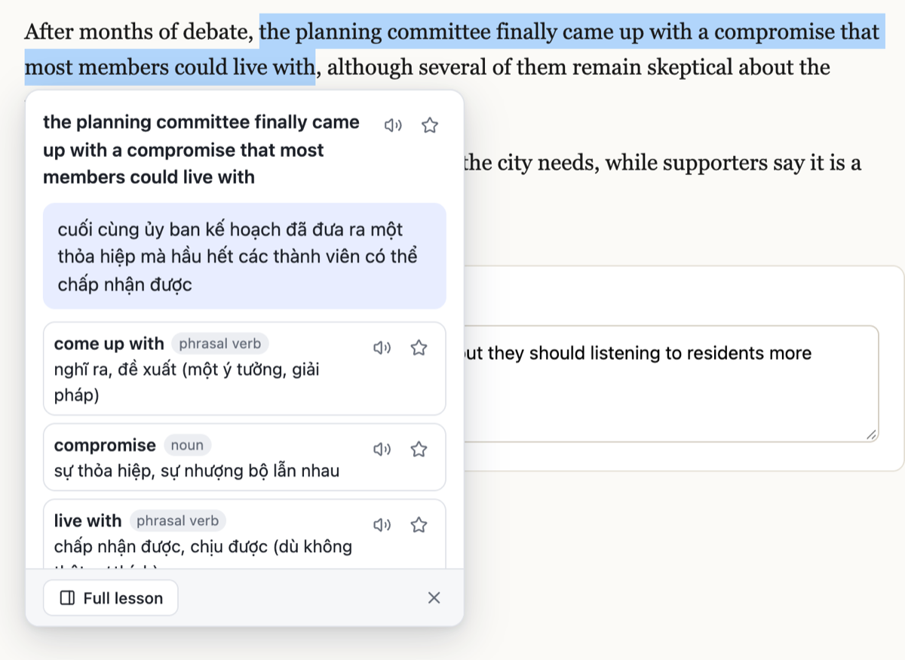
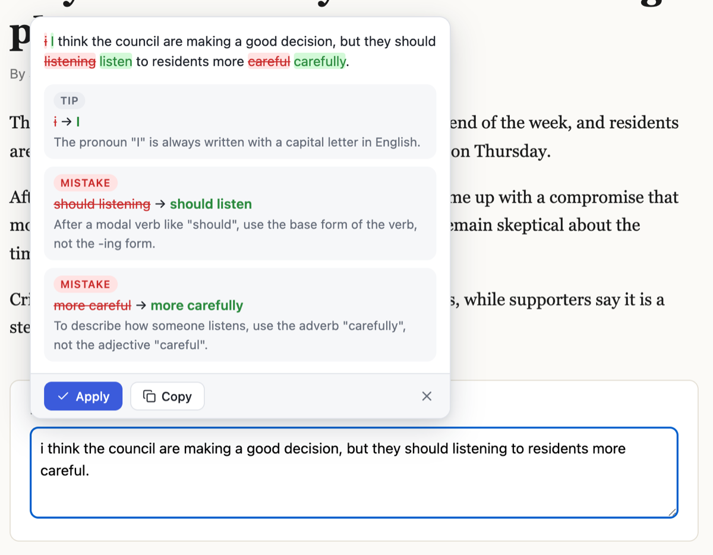
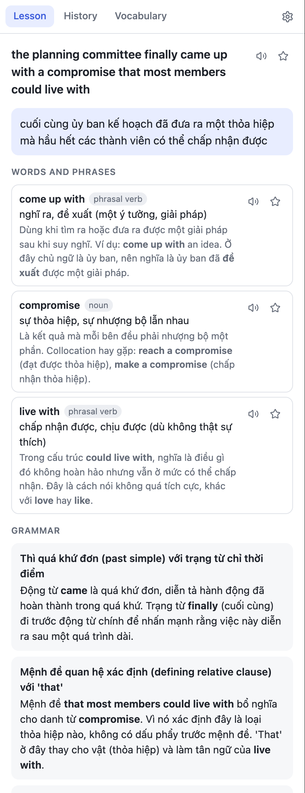
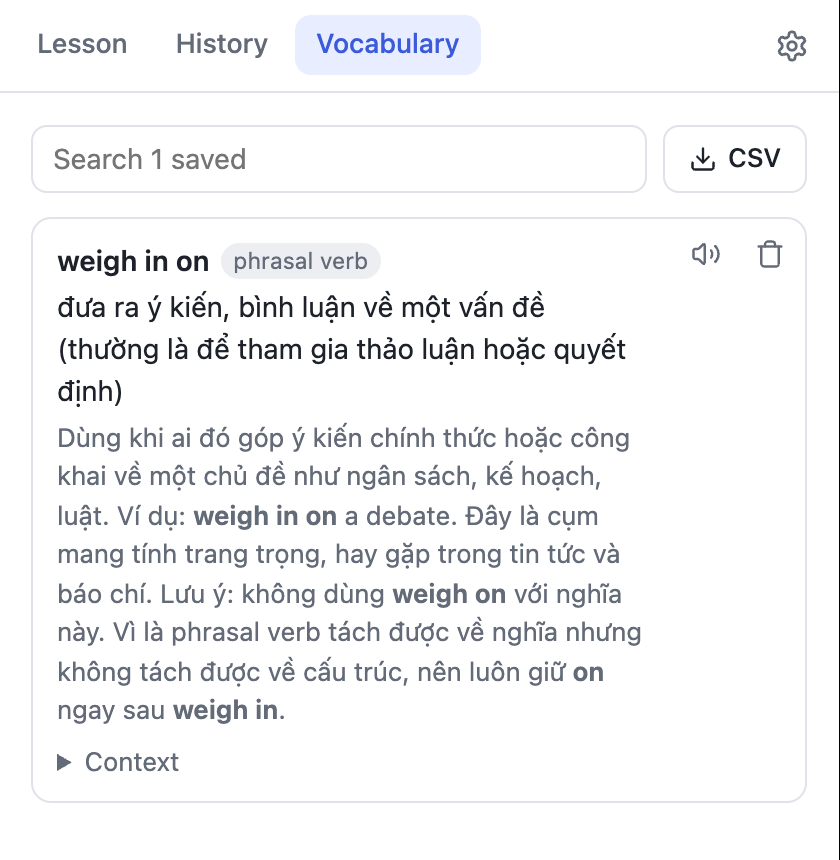
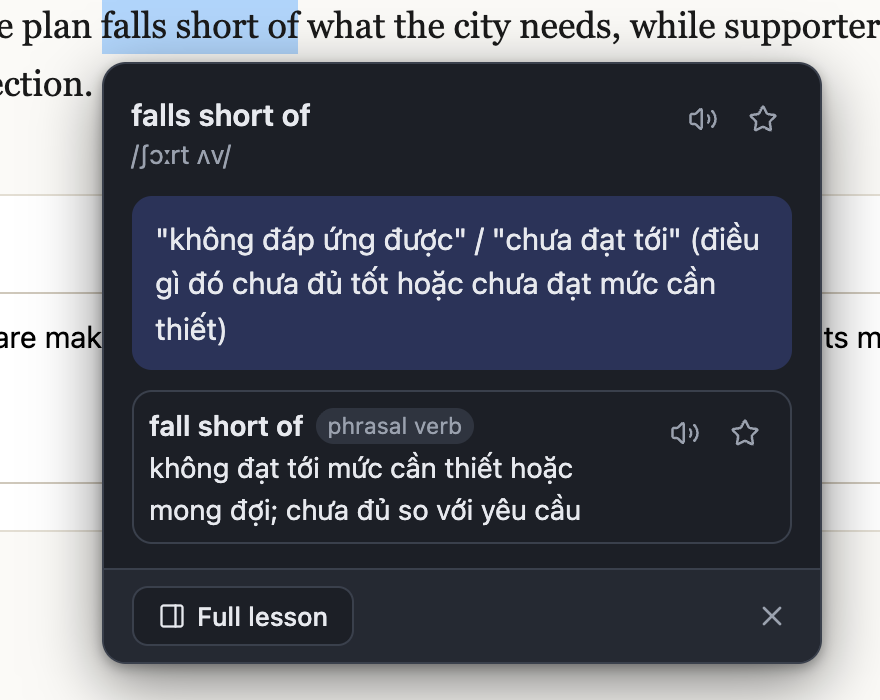

# Translate & Learn

A Chrome extension that turns text you select on any website into a short English lesson, and checks the English you
write in any text box. It brings [paseo-translate](https://github.com/nguyenvanduocit/paseo-translate) (a Paseo plugin)
to the whole web. It runs on your own Claude account: a small local helper hands each request to the Claude Code
installed on your Mac. On a computer without a signed-in Claude Code, it can use an Anthropic API key instead.

- **Translate selection.** Select a word, a phrase or a paragraph, and click **Translate**. A popup next to the
  selection shows the translation (Vietnamese by default) and the key words. **Full lesson** opens Chrome's side panel
  with the whole lesson:
  - a breakdown of the words and phrases worth learning,
  - the grammar at work,
  - reusable sentence patterns,
  - examples.

  The popup fills in as Claude writes and says "Still writing the full lesson…" until the grammar and patterns are
  done too. A word's ☆ works as soon as that word is complete.
- **Check my English.** In any text box (textareas, text inputs and rich editors such as Gmail or Slack), a round button
  appears in the corner. Click it to see your text with removed words in red and added words in green, and one
  explanation per fix, tagged *mistake*, *unnatural* or *tip*. **Apply** writes the corrected text into the box;
  **Copy** copies it.
- **Pronunciation.** A speaker button next to the selection, each word or phrase, each example sentence and each saved
  word reads it aloud. Click it again to stop. It uses the voices on your computer: the most natural one for the accent
  you chose (American or British), or the one you pick, at normal, slow or very slow speed. If a voice can't play, the
  button turns red and its tooltip says why.
- **History.** Every finished lookup is kept (the last 300). You can search the list and open any lookup again.
- **Vocabulary.** Star a word or phrase in a lesson to save it. You can search the list and export it as CSV, which
  Anki can import.

## Screenshots

Select text on a page, and the popup shows the translation and the key words:



**Check my English** marks each fix in the text and explains it:



<table>
  <tr>
    <td width="50%" valign="top">
      <p><b>Full lesson</b> in the side panel: words, grammar and patterns.</p>
      
    </td>
    <td width="50%" valign="top">
      <p><b>Vocabulary</b>: starred words, searchable and exportable as CSV.</p>
      
      <p><b>Dark mode</b> follows the system setting.</p>
      
    </td>
  </tr>
</table>

## Install (unpacked)

You need [Claude Code](https://claude.com/claude-code) signed in to your Claude account, and Node.js 22.18 or later.
It works on macOS and Linux.

```bash
claude auth status        # "loggedIn": true? If not: claude auth login
npm install
npm run build
npm run install-helper    # registers the Claude helper with Chrome, then checks that Claude Code answers
```

1. Open `chrome://extensions` and turn on **Developer mode**.
2. Click **Load unpacked** and choose `.output/chrome-mv3`. It is a hidden folder: in the file dialog, press
   **Cmd + Shift + .** to show it, or **Cmd + Shift + G** to type the path.
3. Click the extension's toolbar icon to open the side panel, then open the gear. **Claude account** should say
   "Connected to your Claude account".

After you load or reload the extension, reload any tab that was already open. Content scripts only run on pages loaded
afterwards. The extension's ID is fixed (`cmkfkcdicodfaedfelcmmgimjmlncgnn`, from the `key` in `helper/extension.json`),
and the helper accepts only that ID.

`npm run uninstall-helper` removes the helper and its Chrome registration. Run `npm run install-helper` again after
moving Claude Code or Node.js, or after `helper/host.ts` changes.

### How the Claude connection works

Chrome can't run programs, and [agentd](https://aiocean.io/project/agentd/) (the Mac app that runs Claude Code for web
pages) refuses `chrome-extension://` origins. So the extension uses Chrome's
[native messaging](https://developer.chrome.com/docs/extensions/develop/concepts/native-messaging): `install-helper`
copies `helper/host.ts` to `~/Library/Application Support/TranslateLearn/` and registers it under the name
`io.translate_learn.claude`, for this extension's ID only. For each lookup, Chrome starts the helper, and the helper runs

```
claude -p --output-format stream-json --include-partial-messages --model <model> --effort low \
  --system-prompt <...> --tools "" --strict-mcp-config --disable-slash-commands --setting-sources "" --no-session-persistence
```

with the prompt on stdin, in an empty folder. It runs with no tools, no MCP servers, no hooks or settings files, and no
saved session. The helper streams the text back to the extension and exits when the extension disconnects.

## Settings

The gear in the side panel opens the settings. They are stored in `chrome.storage.local`, on this browser profile only.

| Setting | What it does |
| --- | --- |
| Claude account | Whether the helper is installed and Claude Code is signed in, with the version and account, or that lookups are using your API key. |
| Anthropic API key (fallback) | Used only when Claude Code isn't set up or signed in (not when it hits a usage limit). Stored only in this browser profile and sent only to `api.anthropic.com`; billed per use to your Anthropic account. |
| Model | Claude Haiku 5.5 (default: fast, light on your plan's usage) or Claude Sonnet 5.5 (better lessons, slower). |
| Translate into | Your language. Translations and explanations are written in it. |
| Your English level | A2 to C1. It sets which words get explained and how simple the explanations of fixes are. |
| Accent, Voice, Speed | How the speaker buttons sound: American or British English; a voice (Automatic picks the most natural, novelty voices are hidden), with a sample to compare; normal, slow (0.75×) or very slow (0.55×). |
| Show the Translate / Check buttons | Turn either button off on every page. |
| Translation prompt | Your own teaching prompt. `{{text}}`, `{{sentence}}`, `{{language}}` and `{{level}}` are filled in. Leave it empty to use the built-in prompt. The JSON reply format is always added after it, so a custom prompt can't break the result. |
| Extra instructions | Added to the end of every lesson prompt, for example "prefer medical senses". |

## How it works

| Path | Runs in | Contents |
| --- | --- | --- |
| `entrypoints/background.ts` | Service worker | Runs every Claude request, keeps the latest lookup, and streams it to the popup and the panel over ports. Opens the side panel. |
| `lib/claude.ts` | Service worker | Picks the way to Claude for each request: the helper first, the API key when Claude Code is not set up or signed in. |
| `lib/helper.ts` | Service worker, panel | One native-messaging port to the helper per request, and the helper's status for the panel. |
| `lib/api.ts` | Service worker | The API key fallback: `@anthropic-ai/sdk`, streaming, `effort: "low"`. |
| `helper/host.ts` | Your Mac (Node.js) | The Claude helper: reads Chrome's framed messages, runs `claude -p`, streams the reply back. |
| `helper/install.ts` | Your Mac | `npm run install-helper`: copies the helper, writes its launcher and Chrome registration, and runs a self-test. |
| `entrypoints/content/` | Every page | The Translate button, the popup, the Check button and card. All of them are rendered with React inside one shadow root, so page CSS can't reach them. |
| `entrypoints/sidepanel/` | Side panel | The Lesson, History, Vocabulary and Settings views. |
| `components/` | Both UIs | The lesson renderer, the diff, inline `**bold**`/`` `code` ``, the speaker button (one at a time; the background worker speaks through `chrome.tts` in `lib/tts.ts`), icons, shared CSS (light and dark). |
| `lib/store.ts` | All three | Access to `chrome.storage`: settings, history and vocabulary in `local`; panel routing in `session`. |
| `shared/` | All three | Pure logic: selection rules, prompts, reply schemas and parsers, the partial-JSON reader for streaming, the word diff, vocabulary and CSV. |

How a lookup flows:

1. The content script decides, on mouse or key release, whether the selection is worth offering. It reads the selection
   plus up to 400 characters around it, and widens a selection that cuts a word to whole words.
2. A click sends the selection to the background worker over the `lookup` port.
3. The worker asks the helper, which runs Claude Code and streams its JSON reply back. `parsePartialReply` turns each prefix into a partial lesson,
   which is pushed to the popup and the panel about 10 times a second.
4. When the reply finishes, `parseReply` validates it with zod and the lookup goes into the history. A reply that fails
   validation is retried once.

The English check sends the text box's text (its first 4000 characters, cut at a sentence end) and gets back
`{ ok, corrected, issues }`. The extension diffs your text against the corrected one word by word; the model never
writes markup. Empty, one-word, mostly-code and non-English texts are not sent.

## Privacy

- Nothing is sent anywhere until you click **Translate** or **Check**.
- **Translate** sends the selection and up to 400 characters around it.
- **Check** sends the text of that one box.
- With Claude Code, the extension sends text only to the helper on your Mac, which passes it to your Claude Code. Claude
  Code sends it to Anthropic under your Claude account, as it does for any prompt you type into it.
- With the API key fallback, the background worker sends it to `api.anthropic.com`, the extension's only host
  permission.
- History, vocabulary and settings stay in this browser profile.

## Development

```bash
npm run dev         # Chrome with the extension loaded and hot reload
npm run typecheck
npm test            # node --test on shared/ and helper/ (selection rules, prompts, parsers, diff, vocabulary, helper protocol)
npm run build       # .output/chrome-mv3
npm run zip
```

`npm test` uses Node's built-in test runner on the TypeScript files directly (Node 22.18 or later).

## Known limits

- Each lookup starts Claude Code afresh. Measured on Haiku 5.5: the translation starts after 1 to 2 seconds, a phrase
  lesson finishes in about 6 seconds and a sentence lesson in about 8; an English check takes about 5.
- Haiku is fast but sometimes gets a translation wrong (once, "weigh in on" came back as "chờ ý kiến", "wait for
  opinions"). Claude Sonnet 5.5, in Settings → Model, is more accurate and slower.
- Lookups and checks count toward your Claude plan's usage limits, like any Claude Code use. When you hit a limit,
  the popup shows Claude's message.
- The helper runs `claude` from where `install-helper` found it, with your login shell's `PATH`. After you move
  Claude Code or Node.js, run `npm run install-helper` again.
- Claude Code still reads your own `~/.claude/CLAUDE.md`, if you have one. The helper skips project files, settings,
  hooks, tools and MCP servers.
- The content script runs in the top frame only. Text inside iframes (some embedded editors and documents) gets no
  buttons.
- **Apply** in a rich editor replaces the whole text through `execCommand("insertText")`, so bold, links and other
  formatting in that box are lost. Use **Copy** there if formatting matters.
- Selections inside text boxes are not offered for translation, so text you are editing is never translated by accident.
- Selections over 5000 characters are ignored.
- Pronunciation uses the voices Chrome's extension speech API (`chrome.tts`) sees, which on macOS are the system's
  voices. The default ones (Samantha, Daniel) sound robotic. For a native-sounding voice, download Apple's free natural
  voices: System Settings → Accessibility → Spoken Content → System voice → Manage Voices… → English (United States) →
  Ava (Premium), Zoe (Premium) or Evan (Enhanced). Restart Chrome; Automatic then picks it. Chrome's online "Google"
  voices are not offered to extensions on macOS.
- Chrome pages (`chrome://`, the Web Store) don't allow content scripts.

## Credits

The selection rules, prompts, reply schema, partial-JSON reader, word diff and feedback rules are adapted from
[paseo-translate](https://github.com/nguyenvanduocit/paseo-translate) by nguyenvanduocit, MIT licensed (see
`LICENSE-paseo-translate`).
